<!-- Enlace «volver arriba» compatible con GitHub: https://github.com/othneildrew/Best-README-Template/pull/73 -->
<a id="readme-top"></a>

<!-- INSIGNIAS DEL PROYECTO -->
[![Contribuidores][contributors-shield]][contributors-url]
[![Forks][forks-shield]][forks-url]
[![Estrellas][stars-shield]][stars-url]
[![Issues][issues-shield]][issues-url]
[![Licencia][license-shield]][license-url]


<!-- LOGO -->
<br />
<div align="center">
  <a href="https://github.com/SebaGRT/YouCook">
    
  </a>

  <h3 align="center">YouCook</h3>

  <p align="center">
    Recetas simples para cocinar con lo que hay en el refri, con alternativas para lo que falta y un asistente de cocina con IA.
    <br />
    <a href="#uso"><strong>Ver capturas »</strong></a>
    <br />
    <br />
    <a href="#primeros-pasos">Instalar</a>
    &middot;
    <a href="https://github.com/SebaGRT/YouCook/issues/new?labels=bug">Reportar un error</a>
    &middot;
    <a href="https://github.com/SebaGRT/YouCook/issues/new?labels=enhancement">Proponer una mejora</a>
  </p>
</div>


<!-- ÍNDICE -->
<details>
  <summary>Índice</summary>
  <ol>
    <li>
      <a href="#acerca-del-proyecto">Acerca del proyecto</a>
      <ul>
        <li><a href="#construido-con">Construido con</a></li>
      </ul>
    </li>
    <li>
      <a href="#primeros-pasos">Primeros pasos</a>
      <ul>
        <li><a href="#requisitos-previos">Requisitos previos</a></li>
        <li><a href="#instalación">Instalación</a></li>
      </ul>
    </li>
    <li><a href="#uso">Uso</a></li>
    <li><a href="#hoja-de-ruta">Hoja de ruta</a></li>
    <li><a href="#contribuir">Contribuir</a></li>
    <li><a href="#licencia">Licencia</a></li>
    <li><a href="#contacto">Contacto</a></li>
    <li><a href="#agradecimientos">Agradecimientos</a></li>
  </ol>
</details>


<!-- ACERCA DEL PROYECTO -->
## Acerca del proyecto

<div align="center">
  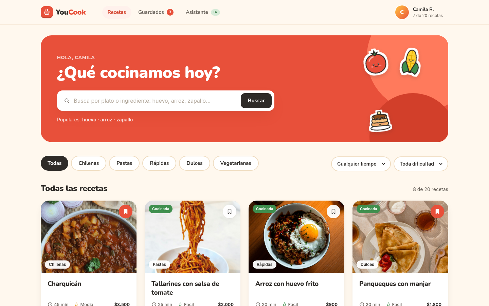
  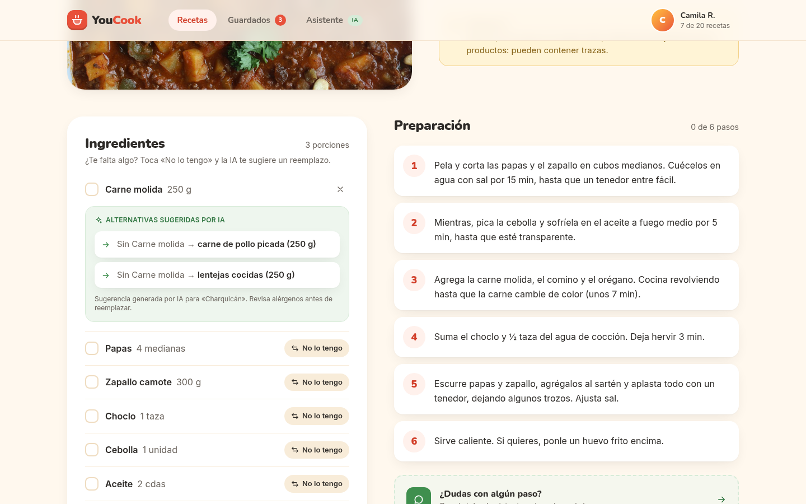
</div>
<br />

**YouCook** es una aplicación web de recetas simples, pensada para quien cocina poco, con presupuesto limitado y a veces sin todos los ingredientes. Está hecha en **PHP con Laravel** y es el proyecto integrador de la Unidad 3 del ramo **IIP323W · Tecnologías y Aplicaciones Web y Móviles** de la Universidad del Desarrollo (2026).

**El problema:** cuando uno está cocinando no hay una manera rápida de resolver una duda o de saber con qué reemplazar un ingrediente que falta, sin ver un video de 15 minutos. Nuestra persona objetivo es Camila, 20 años, estudiante que vive sola o con compañeros: cocina poco, tiene poco presupuesto y quiere aprender platos simples.

Qué se puede hacer:
* **Buscar recetas:** un catálogo de 20 recetas con buscador (por plato o por ingrediente), filtros por categoría, tiempo y dificultad, y paginación. Los filtros quedan en la dirección, así que una búsqueda se puede compartir.
* **«No lo tengo»:** en cada ingrediente, la IA sugiere dos reemplazos fáciles de conseguir en Chile, con su cantidad. La respuesta queda guardada una semana, así que la segunda vez responde al instante y sin gastar cuota.
* **Preguntarle al asistente:** un chat de cocina que conoce la receta que estás mirando. Responde corto, en español de Chile, solo sobre cocina, y advierte sobre alérgenos.
* **Guardar recetas** para después, en la pantalla Guardados.
* **Marcar recetas como cocinadas** para avanzar en el **Reto YouCook**: cada receta cocinada desbloquea un sticker, y el perfil muestra el progreso y el nivel (Principiante, Aprendiz, Chef de pensión y Leyenda de la cocina).
* **Tener una cuenta:** registro, ingreso, salida y edición del nombre y el correo. Cada persona ve solo sus guardadas, sus cocinadas y su conversación.

**Por qué la IA pasa por Laravel:** la clave de Groq no puede llegar al navegador, porque cualquiera podría copiarla. El JavaScript de la página le pide las alternativas o la respuesta del chat a una ruta de Laravel, y es el servidor el que llama a Groq con la clave guardada en `.env`.

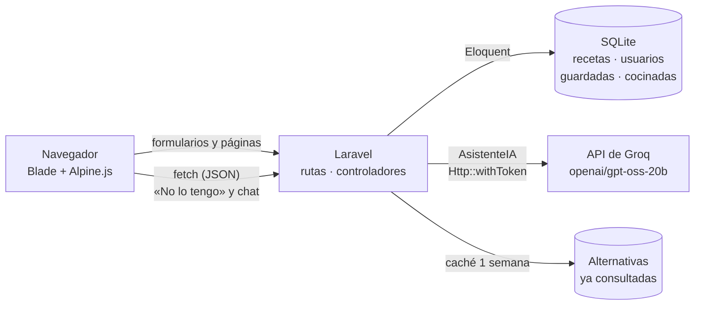

**Lo que vimos en clases y dónde está:**

| En clases | En YouCook |
|---|---|
| Rutas con nombre y middleware `auth` / `guest` (clases 9 y 11) | `routes/web.php`, `routes/auth.php`, `routes/ia.php` |
| Layouts con `@extends`, `@section` y `@yield` (clase 9) | `layouts/app.blade.php` y `layouts/guest.blade.php`, usados por todas las pantallas |
| Llamar a Groq con `Http::withToken(config('services.groq.key'))` (clase 9) | `app/Services/AsistenteIA.php`, con la configuración en `config/services.php` |
| Migraciones, modelos con `$fillable`, `casts()` y `hasMany`, seeders (clase 10) | 4 tablas propias en `database/migrations/`, `Recipe`, `Ingredient` y `User`, y las 20 recetas en `database/data/recetas.php` |
| Controladores con `$request->validate()` (clase 10) | `RecipeController` (filtros), `ProfileController` (editar el perfil), `AssistantController` (chat) |
| Componentes de Blade `<x-…>` (clase 10) | 20 componentes en `resources/views/components/`: tarjeta de receta, fila de ingrediente, stickers, barra de navegación… |
| Registro e ingreso escritos a mano, sin Breeze (clase 11) | `AuthController`: `Auth::attempt`, `Auth::login` y `session()->regenerate()` |
| Datos de cada usuario (clase 11) | Guardadas y cocinadas en tablas pivote por persona (`belongsToMany`); los controladores siempre parten de `$request->user()` |

**Riesgos de la propuesta y cómo los cubre el código:**

| Riesgo | Cómo lo cubrimos |
|---|---|
| Que la IA invente o hable de otra cosa | Mensaje de sistema con reglas (`REGLAS` en `AsistenteIA`): solo cocina, respuestas cortas, «si no sabes, dilo» |
| Alérgenos e intolerancias | Cada receta lista sus alérgenos; la IA debe advertirlos y cada sugerencia dice «Revisa alérgenos antes de reemplazar» |
| Depender de la API | Toda la app funciona sin IA. Si Groq falla, se ve «El asistente no está disponible» con «Reintentar», y el error queda en `storage/logs/laravel.log` |
| Límite del plan gratis | Máximo 20 consultas por minuto por persona (`throttle:20,1`) y las alternativas guardadas una semana en caché |
| Que se use la IA para otra cosa | Las rutas de la IA exigen sesión iniciada y las reglas rechazan temas que no son de cocina |

El diseño sigue el [mockup de Figma](https://www.figma.com/make/YxfgzwAvSW1RFc46TdE6Lj/Mockup-de-YouCook) (en `mockup/`, hecho en React). Diferencias declaradas:
* **Los datos son reales:** guardar, cocinar y el progreso quedan en la base de datos, por persona. En el mockup vivían en memoria.
* **La IA es real** (Groq). En el mockup las respuestas estaban escritas a mano y siempre eran las mismas.
* **20 recetas completas.** El mockup tenía 8 y solo el título de otras 12. Las recetas sin dibujo propio comparten el sticker `estrella`.
* **Niveles sin género:** el mockup decía «Cocinera en entrenamiento». Como el perfil es de cualquier persona, los niveles son Principiante, Aprendiz, Chef de pensión y Leyenda de la cocina.
* **Registro sin confirmar contraseña** y **sin «¿Olvidaste tu contraseña?»**: recuperar la contraseña necesita enviar correos, y eso quedó fuera del alcance.
* **Sin Breeze:** la propuesta decía Laravel Breeze, pero las cuentas se escribieron a mano como en la clase 11, porque Breeze reemplaza el diseño y baja Tailwind a la versión 3.
* **«Editar» en el Perfil funciona** (nombre y correo). En el mockup era solo un botón.

<p align="right">(<a href="#readme-top">volver arriba</a>)</p>


### Construido con

* [![Laravel][Laravel-badge]][Laravel-url]
* [![PHP][PHP-badge]][PHP-url]
* [![SQLite][SQLite-badge]][SQLite-url]
* [![Tailwind CSS][Tailwind-badge]][Tailwind-url]
* [![Alpine.js][Alpine-badge]][Alpine-url]
* [![Vite][Vite-badge]][Vite-url]
* [![Groq][Groq-badge]][Groq-url]

Laravel 13 con Blade y Eloquent, Tailwind CSS 4 (el mismo tema del mockup) y Alpine.js para lo interactivo sin recargar la página. La IA es el modelo `openai/gpt-oss-20b` del plan gratis de Groq. Las fuentes Nunito e Inter se sirven desde el propio sitio.

<p align="right">(<a href="#readme-top">volver arriba</a>)</p>


<!-- PRIMEROS PASOS -->
## Primeros pasos

### Requisitos previos

* **PHP 8.3** o superior y **Composer**
  ```sh
  php -v
  composer -V
  ```
  La forma más corta de tener los dos es [Laravel Herd](https://herd.laravel.com/) o el instalador de [php.new](https://php.new/).
* **Node.js 22** o superior (para compilar el CSS y el JavaScript)
  ```sh
  node --version
  ```
* Una **clave de Groq**, gratis y sin tarjeta, en [console.groq.com/keys](https://console.groq.com/keys). Empieza con `gsk_`. Sin clave la app funciona igual, pero «No lo tengo» y el asistente muestran el estado de error.

### Instalación

1. Clona el repositorio e instala las dependencias:
   ```sh
   git clone https://github.com/SebaGRT/YouCook.git
   cd YouCook/web
   composer install
   npm install
   ```
2. Crea tu `.env` y su clave de aplicación:
   ```sh
   cp .env.example .env
   php artisan key:generate
   ```
3. Pega tu clave de Groq al final de `.env`. **Nunca** la subas al repositorio (`.env` ya está en `.gitignore`):
   ```ini
   GROQ_API_KEY=gsk_...
   GROQ_MODEL=openai/gpt-oss-20b
   ```
4. Crea la base de datos con las 20 recetas y la cuenta de demostración:
   ```sh
   php artisan migrate:fresh --seed
   ```
5. Comprueba la conexión con Groq:
   ```sh
   php artisan ia:probar       # Groq (openai/gpt-oss-20b): «listo» en 0.6 s
   ```
   Si responde `model_not_found`, elige un modelo vigente en [console.groq.com/docs/models](https://console.groq.com/docs/models) y cámbialo en `GROQ_MODEL`.

<p align="right">(<a href="#readme-top">volver arriba</a>)</p>


<!-- USO -->
## Uso

Desde `web/`:

```sh
# Desarrollo: servidor y Vite juntos, en http://localhost:8000
composer run dev

# O compilado, como para la presentación
npm run build && php artisan serve
```

**Cuenta de demostración:** `camila.rojas@uni.cl` / `password`. Tiene 3 recetas guardadas y 7 cocinadas. También puedes crear tu propia cuenta en `/registro`.

**Pruebas:**

```sh
cd web && php artisan test     # 40 pruebas; ninguna llama a la API real (Http::fake)
vendor/bin/pint --test         # formato del código PHP
```

**Recorrido:** Ingreso → Catálogo (buscar «zapallo», filtrar por Chilenas) → Charquicán → «No lo tengo» en un ingrediente → Asistente → Guardar la receta → Marcarla como cocinada → Perfil con el nuevo sticker.

| | | |
|:---:|:---:|:---:|
| 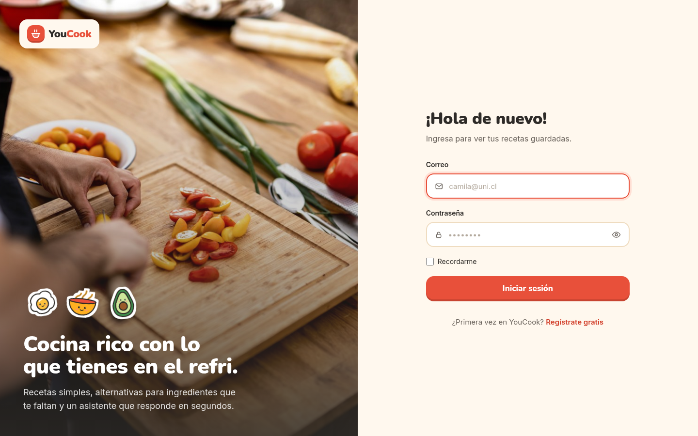<br>Ingreso | 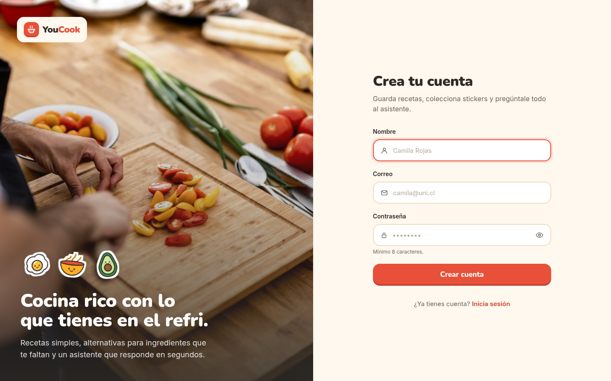<br>Registro | <br>Catálogo |
| 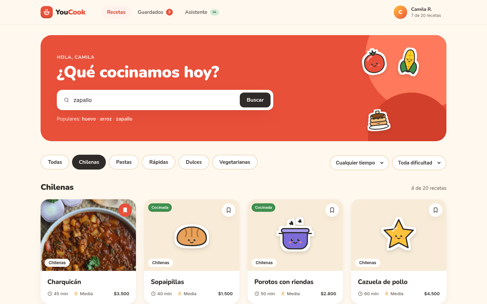<br>Búsqueda y filtros | 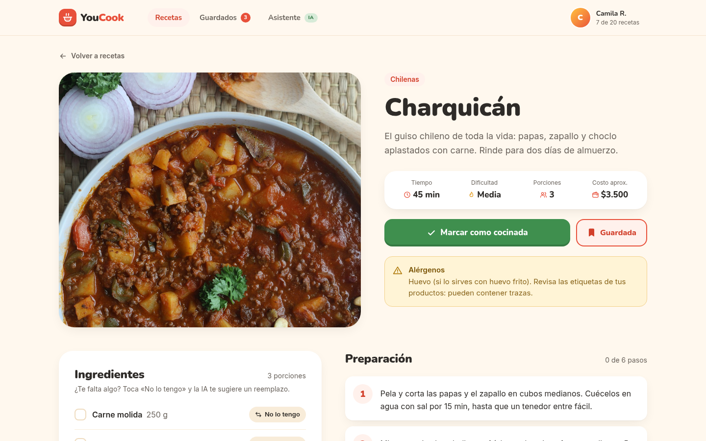<br>Detalle de receta | <br>«No lo tengo» con IA |
| 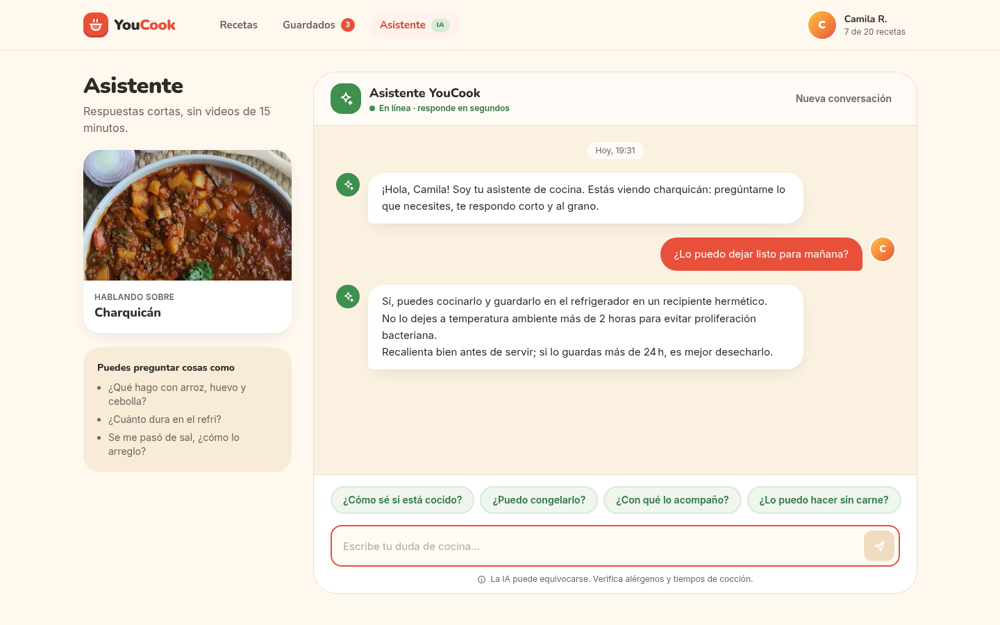<br>Asistente | 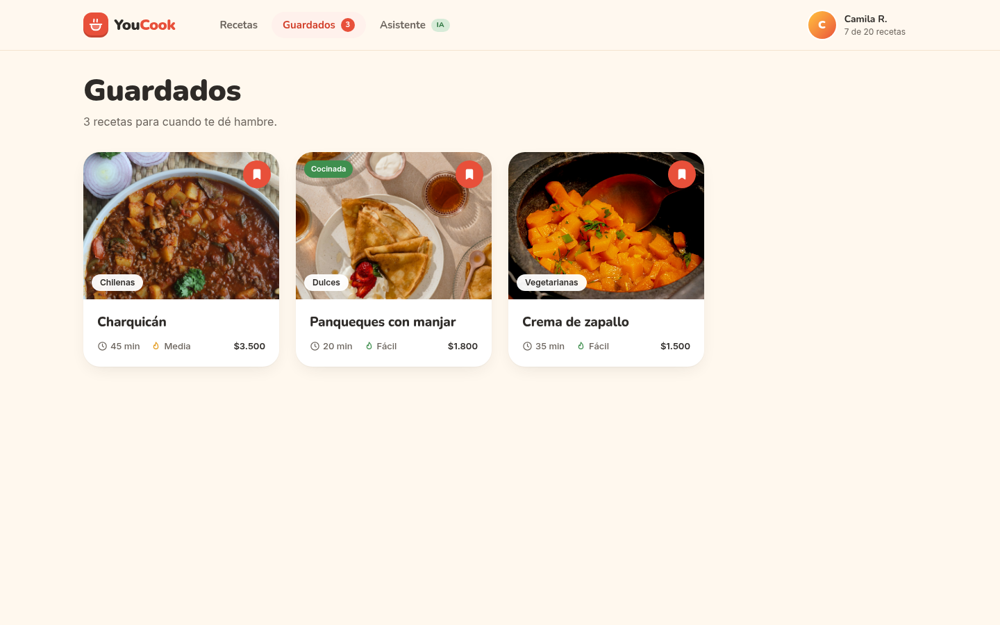<br>Guardados | 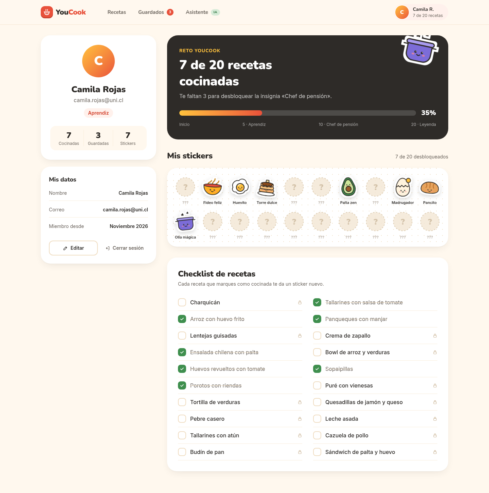<br>Perfil y Reto YouCook |

**En el teléfono** la barra de arriba se reduce al logo y la navegación pasa a una barra inferior:

| | | | | |
|:---:|:---:|:---:|:---:|:---:|
| 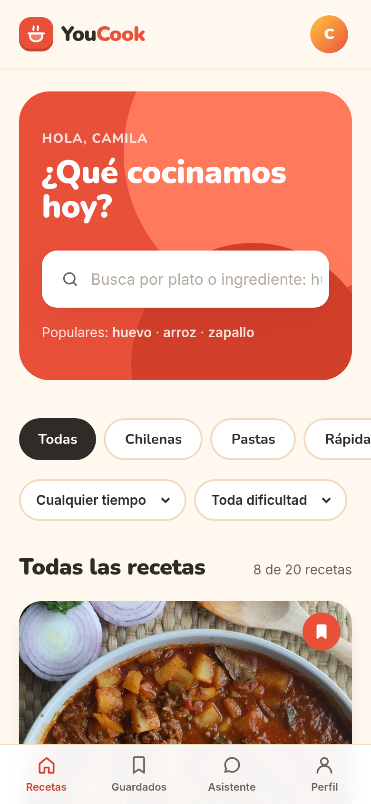<br>Catálogo | 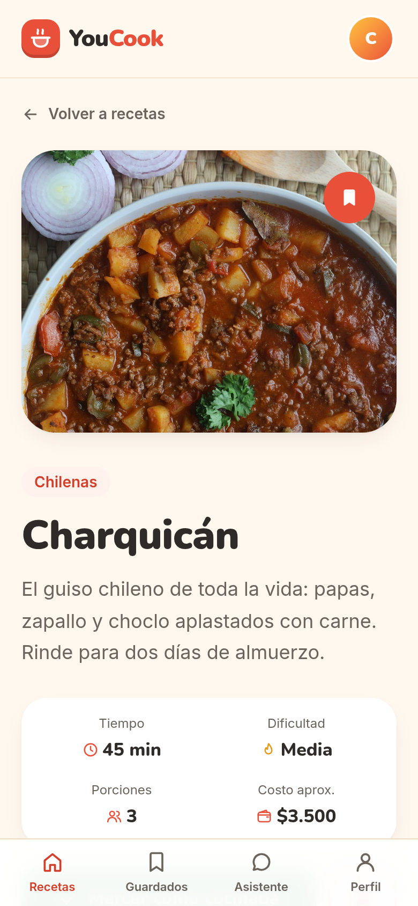<br>Detalle | 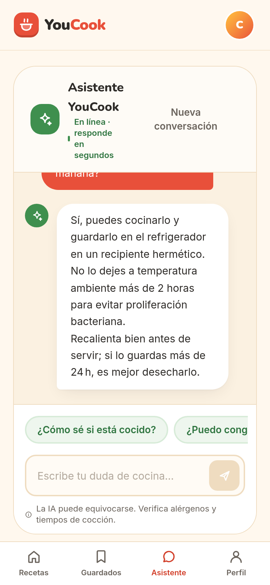<br>Asistente | 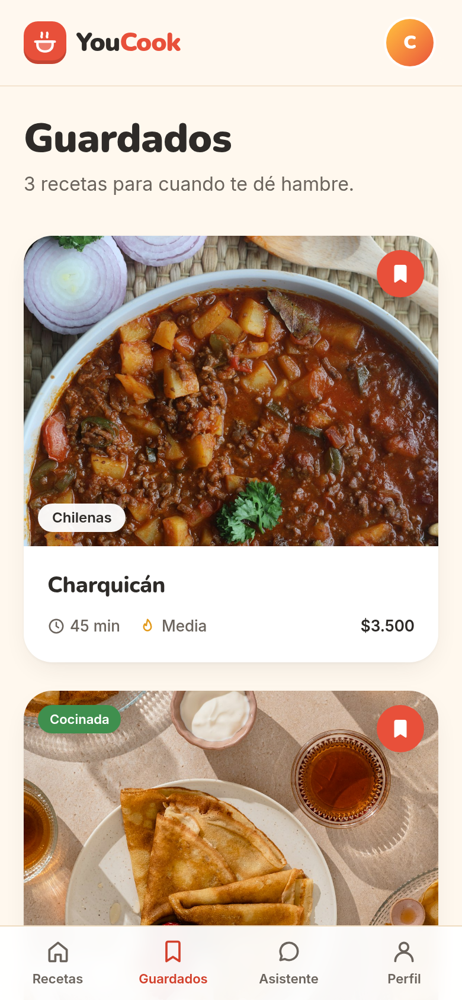<br>Guardados | 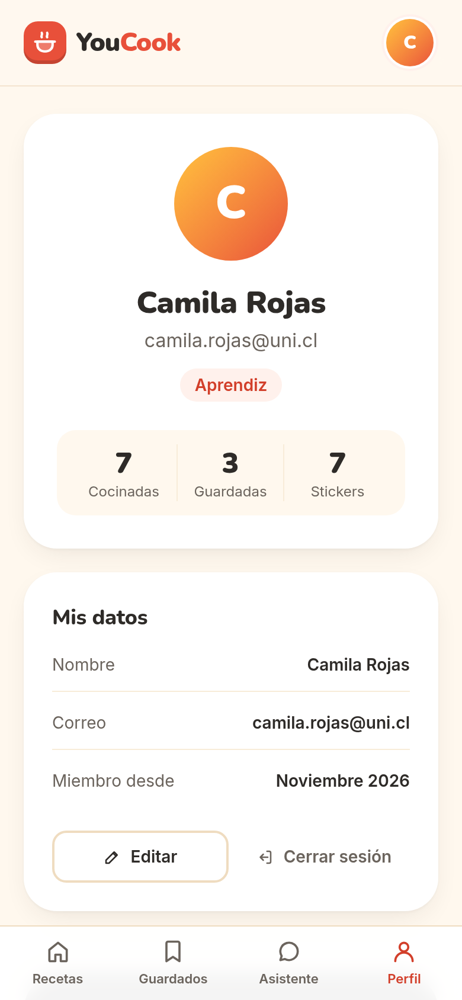<br>Perfil |

Las respuestas de la IA que se ven en las capturas son reales: las dio Groq al tomarlas.

<p align="right">(<a href="#readme-top">volver arriba</a>)</p>


<!-- HOJA DE RUTA -->
## Hoja de ruta

- [x] Catálogo de 20 recetas con buscador, filtros y paginación
- [x] Registro, ingreso y perfil editable
- [x] Guardar recetas y marcarlas como cocinadas, por persona
- [x] Alternativas para ingredientes con Groq, con caché
- [x] Asistente de cocina con Groq que conoce la receta abierta
- [x] Reto YouCook: stickers, progreso y niveles
- [x] Diseño del mockup, también en el teléfono
- [ ] Fotos para las 7 recetas que todavía muestran su sticker
- [ ] Recuperar la contraseña por correo
- [ ] Publicar la app en internet con HTTPS
- [ ] Que cada persona pueda subir sus propias recetas

**Limitaciones conocidas:**
* Sopaipillas, Porotos con riendas, Puré con vienesas, Pebre casero, Leche asada, Cazuela de pollo y Budín de pan no tienen foto: muestran su sticker.
* La IA puede equivocarse. Por eso cada respuesta lo advierte y pide revisar alérgenos y tiempos de cocción.
* La conversación del asistente se guarda solo mientras dura la sesión.
* El plan gratis de Groq tiene límites por minuto y por día para toda la clave.

Ver los [issues abiertos](https://github.com/SebaGRT/YouCook/issues) para la lista completa.

<p align="right">(<a href="#readme-top">volver arriba</a>)</p>


<!-- CONTRIBUIR -->
## Contribuir

YouCook es un proyecto académico: solo los integrantes del equipo suben código. Igual puedes [abrir un issue](https://github.com/SebaGRT/YouCook/issues) para reportar errores o proponer mejoras.

Así trabaja el equipo:

1. Una rama por tarea, con tu nombre (`git switch -c nombre/diaN-tema`)
2. Antes de cada commit, revisar que todo esté en verde (`vendor/bin/pint && npm run build && php artisan test`)
3. Commit con un mensaje que diga qué cambia (`git commit -m 'Guardados y Perfil del mockup'`)
4. Subir la rama (`git push -u origin nombre/diaN-tema`)
5. Abrir un Pull Request (`gh pr create --fill`). Sebastián lo integra a `main`

### Contribuidores

<a href="https://github.com/SebaGRT/YouCook/graphs/contributors">
  
</a>

<p align="right">(<a href="#readme-top">volver arriba</a>)</p>


<!-- LICENCIA -->
## Licencia

Sin licencia. Es un proyecto académico y sus autores se reservan todos los derechos: el código se puede leer, pero no copiar, modificar ni distribuir sin su permiso.

Las fotos de las recetas son de [Unsplash](https://unsplash.com/) y se usan según su [licencia](https://unsplash.com/license). Las fuentes Nunito e Inter tienen licencia [SIL Open Font License](https://openfontlicense.org/).

<p align="right">(<a href="#readme-top">volver arriba</a>)</p>


<!-- CONTACTO -->
## Contacto

* **Sebastián Herrera S.**, líder del grupo, IA e integración: [@SebaGRT](https://github.com/SebaGRT) · s.herreras@udd.cl
* **Emma Westcott S.**, diseño y frontend: [@EmmaUDD](https://github.com/EmmaUDD) · e.westcotts@udd.cl
* **Miguel Figueroa G.**, backend: [@FGEMiguel](https://github.com/FGEMiguel) · m.figueroag@udd.cl

Enlace del proyecto: [https://github.com/SebaGRT/YouCook](https://github.com/SebaGRT/YouCook)

<p align="right">(<a href="#readme-top">volver arriba</a>)</p>


<!-- AGRADECIMIENTOS -->
## Agradecimientos

* [Universidad del Desarrollo](https://www.udd.cl/), ramo IIP323W · Tecnologías y Aplicaciones Web y Móviles
* [Groq](https://console.groq.com/docs), por la API de IA
* [Documentación de Laravel](https://laravel.com/docs)
* [Tailwind CSS](https://tailwindcss.com/docs) y [Alpine.js](https://alpinejs.dev/)
* [Unsplash](https://unsplash.com/), por las fotos de las recetas
* [Google Fonts](https://fonts.google.com/): [Nunito](https://fonts.google.com/specimen/Nunito) e [Inter](https://fonts.google.com/specimen/Inter)
* [Best-README-Template](https://github.com/othneildrew/Best-README-Template), la plantilla de este README
* [Shields.io](https://shields.io) y [contrib.rocks](https://contrib.rocks), por las insignias y la imagen de contribuidores

<p align="right">(<a href="#readme-top">volver arriba</a>)</p>


<!-- ENLACES E IMÁGENES EN ESTILO REFERENCIA -->
[contributors-shield]: https://img.shields.io/github/contributors/SebaGRT/YouCook.svg?style=for-the-badge
[contributors-url]: https://github.com/SebaGRT/YouCook/graphs/contributors
[forks-shield]: https://img.shields.io/github/forks/SebaGRT/YouCook.svg?style=for-the-badge
[forks-url]: https://github.com/SebaGRT/YouCook/network/members
[stars-shield]: https://img.shields.io/github/stars/SebaGRT/YouCook.svg?style=for-the-badge
[stars-url]: https://github.com/SebaGRT/YouCook/stargazers
[issues-shield]: https://img.shields.io/github/issues/SebaGRT/YouCook.svg?style=for-the-badge
[issues-url]: https://github.com/SebaGRT/YouCook/issues
[license-shield]: https://img.shields.io/badge/licencia-sin%20licencia-lightgrey.svg?style=for-the-badge
[license-url]: #licencia
[Laravel-badge]: https://img.shields.io/badge/Laravel-FF2D20?style=for-the-badge&logo=laravel&logoColor=white
[Laravel-url]: https://laravel.com/
[PHP-badge]: https://img.shields.io/badge/PHP-777BB4?style=for-the-badge&logo=php&logoColor=white
[PHP-url]: https://www.php.net/
[SQLite-badge]: https://img.shields.io/badge/SQLite-003B57?style=for-the-badge&logo=sqlite&logoColor=white
[SQLite-url]: https://www.sqlite.org/
[Tailwind-badge]: https://img.shields.io/badge/Tailwind_CSS-06B6D4?style=for-the-badge&logo=tailwindcss&logoColor=white
[Tailwind-url]: https://tailwindcss.com/
[Alpine-badge]: https://img.shields.io/badge/Alpine.js-8BC0D0?style=for-the-badge&logo=alpinedotjs&logoColor=black
[Alpine-url]: https://alpinejs.dev/
[Vite-badge]: https://img.shields.io/badge/Vite-646CFF?style=for-the-badge&logo=vite&logoColor=white
[Vite-url]: https://vite.dev/
[Groq-badge]: https://img.shields.io/badge/Groq-F55036?style=for-the-badge&logoColor=white
[Groq-url]: https://groq.com/
